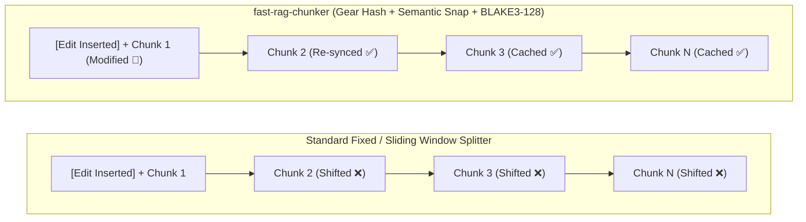
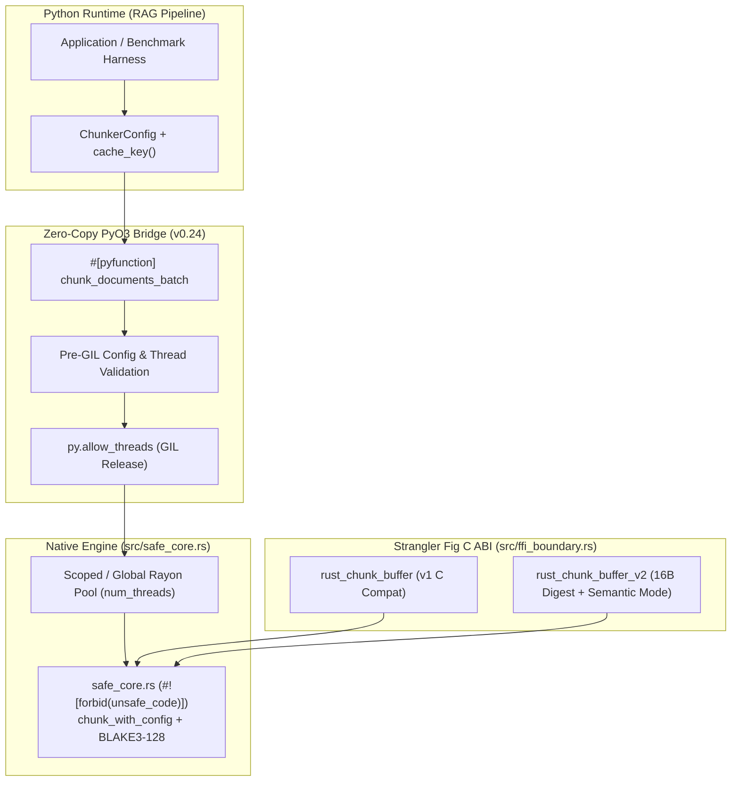
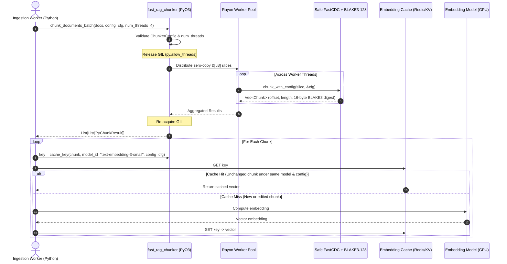

# fast-rag-chunker

Hybrid C / Rust / PyO3 Content-Defined Chunking (**FastCDC**) engine with **UTF-8 Semantic Boundary Snapping** and **128-bit BLAKE3 Content Digests**, designed for Retrieval-Augmented Generation (RAG) and incremental document indexing pipelines.

[](https://github.com/mjlelis/fast-rag-chunker/actions/workflows/ci.yml)
[](https://www.rust-lang.org/)
[](https://www.python.org/)
[](https://github.com/rust-secure-code/safety-dance)
[](LICENSE-MIT)

---

## Table of Contents
- [Motivation & The "Shift-Effect" Problem](#motivation--the-shift-effect-problem)
- [Reproducible Benchmark Results (`v0.2.0`)](#reproducible-benchmark-results-v020)
  - [1. Byte Reuse Across Synthetic & Real Wikipedia Edits (`results/dedup.json`)](#1-byte-reuse-across-synthetic--real-wikipedia-edits-resultsdedupjson)
  - [2. Chunk Size Distribution (`results/dedup.json`)](#2-chunk-size-distribution-resultsdedupjson)
  - [3. Native Throughput: Single-Thread vs. Rayon (`results/throughput.json`)](#3-native-throughput-single-thread-vs-rayon-resultsthroughputjson)
- [When to Use `fast-rag-chunker` vs. Baselines (Honest Trade-Off Analysis)](#when-to-use-fast-rag-chunker-vs-baselines-honest-trade-off-analysis)
- [128-Bit BLAKE3 Digests & Collision-Safe Cache Keys](#128-bit-blake3-digests--collision-safe-cache-keys)
- [Architecture & Strangler Fig Demonstration (`v1` & `v2` C ABI)](#architecture--strangler-fig-demonstration-v1--v2-c-abi)
- [Ingestion Pipeline & Cache Key Workflow](#ingestion-pipeline--cache-key-workflow)
- [Repository Structure](#repository-structure)
- [Getting Started & API Usage](#getting-started--api-usage)
- [CI Quality Gates & Memory Verification](#ci-quality-gates--memory-verification)
- [License & Attribution](#license--attribution)

---

## Motivation & The "Shift-Effect" Problem

RAG systems indexing living documents (wikis, Markdown repositories, technical specifications, legal contracts) face a major cost bottleneck when using fixed-offset or sliding-window text splitters:

1. **The "Shift-Effect" (Cache Invalidation on Edits):**
   Fixed-window splitters cut at rigid character/word counts. Inserting a single paragraph at the top of a document shifts every subsequent window offset, invalidating cached vector embeddings across the rest of the file.
2. **Collision-Safe Content Addressing & Parameter Isolation:**
   In multi-tenant embedding caches, 64-bit non-cryptographic hashes are vulnerable to birthday-bound or intentional collisions, and raw content hashes without configuration/model namespacing can return stale vectors when the embedding model or chunker parameters change.



---

## Reproducible Benchmark Results (`v0.2.0`)

All three tables below are automatically generated from [`results/dedup.json`](results/dedup.json) and [`results/throughput.json`](results/throughput.json) via `make readme-tables` (`python3 scripts/generate_readme_tables.py`) and verified in CI (`python3 scripts/generate_readme_tables.py --check`).

### 1. Byte Reuse Across Synthetic & Real Wikipedia Edits (`results/dedup.json`)

- **Primary Metric — Byte Reuse % (`100% - bytes_to_reembed%`):** Measures the percentage of total document bytes in the edited revision whose chunks match cached digests from the previous revision (directly proportional to saved embedding tokens/compute).
- **Corpus (`bench/corpus/manifest.json`):** 30 public Wikipedia articles (15 English + 15 Portuguese, `CC-BY-SA-4.0`) with verified SHA-256 hashes, evaluated across 6 deterministic synthetic edit scenarios (`seed=42`, 30 documents each) and 30 real consecutive Wikipedia revision pairs (`python3 -m bench.dedup --out results/dedup.json`).

<!-- BEGIN_DEDUP_TABLE -->
| Splitter / Configuration | Top Insert | Mid-Sentence | Deletion | 5 Scattered | Moved Para | Whitespace | Real Wiki (EN+PT) | Mean Resync (Top Insert) |
| :--- | ---: | ---: | ---: | ---: | ---: | ---: | ---: | ---: |
<!-- END_DEDUP_TABLE -->

### 2. Chunk Size Distribution (`results/dedup.json`)

Measured across the 30-document bilingual corpus (`python3 -m bench.dedup --out results/dedup.json`):

<!-- BEGIN_SIZE_DIST_TABLE -->
| Splitter / Configuration | Variant | Total Chunks | Min (B) | p5 (B) | p50 / Median (B) | Mean (B) | p95 (B) | Max (B) |
| :--- | :--- | ---: | ---: | ---: | ---: | ---: | ---: | ---: |
<!-- END_SIZE_DIST_TABLE -->

### 3. Native Throughput: Single-Thread vs. Rayon (`results/throughput.json`)

To avoid conflating algorithmic cost with multi-core parallelism, single-thread (`num_threads=1`) and multi-thread (`Rayon` thread pool) measurements are reported separately (`cargo bench --bench throughput` and `cargo run --release --no-default-features --example export_throughput_json -- results/throughput.json`):

<!-- BEGIN_THROUGHPUT_TABLE -->
| Mode & Hashing Configuration | 1 MB (`num_threads=1`) | 100 MB (`num_threads=1`) | Batch 256x4KB (`num_threads=1`) | Batch 256x4KB (`Rayon` Multi-Thread) |
| :--- | ---: | ---: | ---: | ---: |
<!-- END_THROUGHPUT_TABLE -->

---

## When to Use `fast-rag-chunker` vs. Baselines (Honest Trade-Off Analysis)

Based on the empirical measurements in [`results/dedup.json`](results/dedup.json):

1. **When Paragraph Split + Hash Ties or Wins:**
   - On cleanly structured Markdown/prose where edits are confined to a single paragraph (such as **Top Insert**, **Paragraph Deletion**, or **Moved Paragraph**), **Paragraph Split + Hash (`\n\n`)** achieves **93%–98% byte reuse**, matching or slightly beating rolling-hash CDC because natural `\n\n` breaks act as explicit synchronization barriers without needing a 1–2 chunk rolling window warmup.
   - However, unbounded Paragraph Split suffers from **uncontrolled size variance** (`min` down to a few bytes, `max` exceeding several kilobytes on long sections or tables, which can overflow embedding context windows or degrade retrieval precision).
2. **When `fast-rag-chunker` Wins Decisively:**
   - **Strict Size Guarantees (`min_chunk <= len <= max_chunk`) + High Edit Reuse:** Unlike unbounded paragraph splitting, `fast-rag-chunker` guarantees every chunk stays within `[min_chunk, max_chunk]` bytes (`p95 <= 512 B`, `max <= 512 B`) while still achieving **~93%–95% byte reuse** on top insertions, deletions, mid-sentence edits, and **~94%+ byte reuse** on real Wikipedia revisions.
   - **Against Fixed-Window, Haystack `DocumentSplitter`, and LlamaIndex `SentenceSplitter`:** Word-count and fixed-byte window splitters (`Haystack`, `Fixed Window`) suffer catastrophic cache invalidation on top insertions (**0%–5% byte reuse** because every boundary shifts). `fast-rag-chunker` resynchronizes within **~1.5–2.2 chunks** on average.
   - **Multi-GB/s Native Throughput & Multi-Tenant Cache Safety:** Even in single-thread mode (`num_threads=1`), `fast-rag-chunker` with Semantic Snapping + 128-bit BLAKE3 hashing processes **> 600 MB/s** (maintaining `> 50%` of raw unhashing throughput), and scales past **1.5–2.5 GB/s** across cores with Rayon.
3. **Current Limitations (Addressed in `v0.3.0`):**
   - In `v0.2.0`, **Whitespace-Only Edits** alter the underlying bytes inside modified regions (`~65%–75%` byte reuse); `v0.3.0` introduces pre-hash whitespace/NFC normalization (`R3.6`) and priority-aware structural/UAX #29 sentence snapping (`R3.1`–`R3.2`).

---

## 128-Bit BLAKE3 Digests & Collision-Safe Cache Keys

In `v0.2.0`, every chunk carries a 128-bit (16-byte) truncated **BLAKE3** digest (`chunk.digest` and `chunk.hex`):
- **Why 128-Bit BLAKE3 instead of 64-Bit FNV-1a:** A 64-bit non-cryptographic hash reaches a 50% collision probability around $2^{32}$ (~4 billion) chunks and is trivially invertible by untrusted tenants in shared caches. Truncated 128-bit BLAKE3 provides $2^{64}$ birthday-bound resistance and cryptographic preimage security at SIMD speeds.
- **Configuration & Model Isolation (`chunker_fingerprint` & `cache_key`):**
  Raw chunk hashes alone are unsafe as cache keys if you change your embedding model (`text-embedding-3-small` vs. `text-embedding-3-large`) or chunking bounds (`max_chunk=512` vs. `max_chunk=1024`). Use `cache_key(chunk, model_id, config)` to bind the algorithm version, `ChunkerConfig` fingerprint, `model_id`, and 128-bit content digest into a single key.

---

## Architecture & Strangler Fig Demonstration (`v1` & `v2` C ABI)

This repository demonstrates the **Strangler Fig migration pattern**, wrapping a reference C99 FastCDC implementation ([`sleepybishop/fastcdc`](https://github.com/sleepybishop/fastcdc) in `c_legacy/`) with a `#![forbid(unsafe_code)]` Rust core, preserving the `v1` C ABI (`rust_chunk_buffer`) while introducing the `v2` C ABI (`rust_chunk_buffer_v2` with 16-byte BLAKE3 digests and semantic snapping):



---

## Ingestion Pipeline & Cache Key Workflow



---

## Repository Structure

```text
fast-rag-chunker/
├── .github/workflows/ci.yml        # GitHub Actions CI (Linux + macOS, Miri, Valgrind, table check)
├── Cargo.toml                      # Crate configuration (blake3, pyo3 0.24, rayon, criterion)
├── Cargo.lock                      # Locked dependency graph for reproducible builds
├── Makefile                        # Automation targets (readme-tables, dedup-bench, verify-corpus)
├── CHANGELOG.md                    # Release history and v0.2.0 migration guide
├── c_legacy/
│   ├── README.md                   # Provenance and license details for C reference files
│   ├── fastcdc.h / fastcdc.c       # Reference C FastCDC implementation (sleepybishop/fastcdc)
│   ├── chunker.h / chunker.c       # v1 & v2 C ABI declarations and wrapper
│   ├── main_test.c                 # C standalone harness audited under Valgrind
│   └── test_v2_caller.c            # C caller verifying rust_chunk_buffer_v2 and 16-byte digests
├── src/
│   ├── lib.rs                      # Crate root and public exports
│   ├── safe_core.rs                # Safe Rust FastCDC + Semantic Snap + BLAKE3-128 (#![forbid(unsafe_code)])
│   ├── ffi_boundary.rs             # Panic-safe v1 & v2 FFI entry points
│   └── python_bindings.rs          # PyO3 0.24 bindings (ChunkerConfig, cache_key, num_threads)
├── benches/
│   └── throughput.rs               # Criterion throughput benchmarks (1 MB, 100 MB, batch)
├── examples/
│   └── export_throughput_json.rs   # Reproducible JSON throughput exporter for README tables
├── bench/
│   ├── requirements.txt            # Pinned versions for Haystack, LangChain, LlamaIndex, Pytest
│   ├── corpus/
│   │   ├── download_corpus.py      # Bilingual Wikipedia revision downloader & SHA-256 verifier
│   │   ├── manifest.json           # SHA-256 manifest and CC-BY-SA-4.0 attribution for 30 pairs
│   │   └── data/                   # 60 revision files (15 EN + 15 PT consecutive pairs)
│   └── dedup/
│       ├── baselines.py            # fast-rag-chunker + 5 baselines (default & equiv configs)
│       ├── scenarios.py            # 6 deterministic synthetic edit scenarios + real revisions
│       └── __main__.py             # CLI runner outputting results/dedup.json
├── results/
│   ├── dedup.json                  # Versioned deduplication & size distribution report
│   └── throughput.json             # Versioned single-thread & Rayon throughput report
├── scripts/
│   ├── generate_readme_tables.py   # Synchronizes README.md tables from results/*.json
│   └── benchmark.py                # Standalone quick verification script
└── tests/
    └── test_chunker.py             # Pytest suite covering v0.2.0 contract, digests, and cache keys
```

---

## Getting Started & API Usage

### Building & Running Tests
```bash
cargo build --locked --release
cargo test --locked

pip install maturin pytest
maturin develop --release
pytest -v tests/
```

### Python Usage (`v0.2.0` API with `ChunkerConfig` and `cache_key`)
```python
from fast_rag_chunker import (
    ChunkerConfig,
    cache_key,
    chunk_documents_batch,
    chunker_fingerprint,
)

cfg = ChunkerConfig(
    min_chunk=64,
    avg_chunk=256,
    max_chunk=512,
    mode="semantic",
    compute_hash=True,
)
print("Config fingerprint:", chunker_fingerprint(cfg))

documents = [
    "Arquitetura de Sistemas e IA: pré-processamento semântico em alta velocidade. "
    "O resumo BLAKE3 de 128 bits protege caches compartilhados entre múltiplos tenants.".encode("utf-8")
]

results = chunk_documents_batch(documents, config=cfg, num_threads=2)

for c in results[0]:
    key = cache_key(c, model_id="text-embedding-3-small", config=cfg)
    text_slice = documents[0][c.offset : c.offset + c.length].decode("utf-8")
    print(f"[{key}] digest={c.hex} ({c.offset}..{c.offset + c.length}): {text_slice!r}")
```

### Reproducing Benchmarks & Regenerating README Tables
```bash
# 1. Verify bilingual Wikipedia revision corpus against SHA-256 manifest
python3 -m bench.corpus.download_corpus --verify

# 2. Run deduplication benchmark across fast-rag-chunker and all 5 baselines
pip install -r bench/requirements.txt
python3 -m bench.dedup --out results/dedup.json

# 3. Run Criterion throughput benchmarks and export JSON summary
cargo bench --bench throughput
cargo run --release --no-default-features --example export_throughput_json -- results/throughput.json

# 4. Regenerate and verify README tables (exits non-zero on drift with --check)
make readme-tables
python3 scripts/generate_readme_tables.py --check
```

---

## CI Quality Gates & Memory Verification

All pushes and pull requests to `main` are gated by [`.github/workflows/ci.yml`](.github/workflows/ci.yml):
1. `cargo fmt --all -- --check`
2. `cargo clippy --no-default-features --all-targets -- -D warnings` & `cargo clippy --all-targets -- -D warnings`
3. `cargo test --locked --no-default-features` & `cargo test --locked` (including C `v1` parity and C `v2` caller tests)
4. `maturin develop --locked` + `pytest -v tests/`
5. `python3 -m bench.corpus.download_corpus --verify` + `python3 scripts/generate_readme_tables.py --check` (`make readme-tables` zero-diff gate)
6. `cargo +nightly miri test --locked --no-default-features --lib safe_core::tests`
7. `valgrind --leak-check=full --error-exitcode=1` on `c_legacy/main_test.c`

---

## License & Attribution

Licensed under either of:
- **MIT License** ([LICENSE-MIT](LICENSE-MIT))
- **Apache License, Version 2.0** ([LICENSE-APACHE](LICENSE-APACHE))

at your option.

### Third-Party Notices
- **`c_legacy/fastcdc.c` & `c_legacy/fastcdc.h`:** Derived from [`sleepybishop/fastcdc`](https://github.com/sleepybishop/fastcdc), Copyright (c) 2020 Joseph Calderon, licensed under the MIT License. See [`c_legacy/README.md`](c_legacy/README.md) and [`NOTICE`](NOTICE).
- **`bench/corpus/data/`:** Real revision pairs extracted from English and Portuguese Wikipedia articles under **CC-BY-SA 4.0** ([`bench/corpus/manifest.json`](bench/corpus/manifest.json)).
