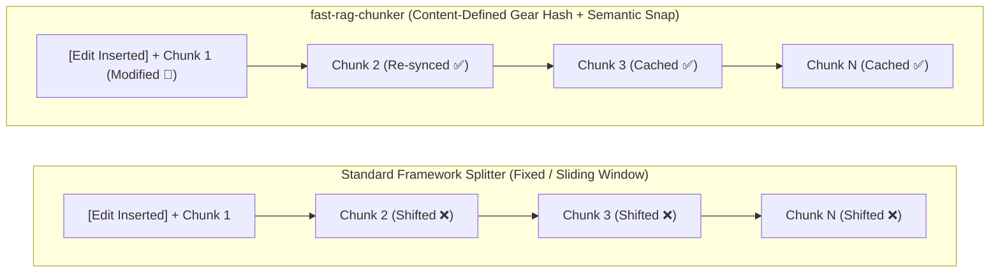
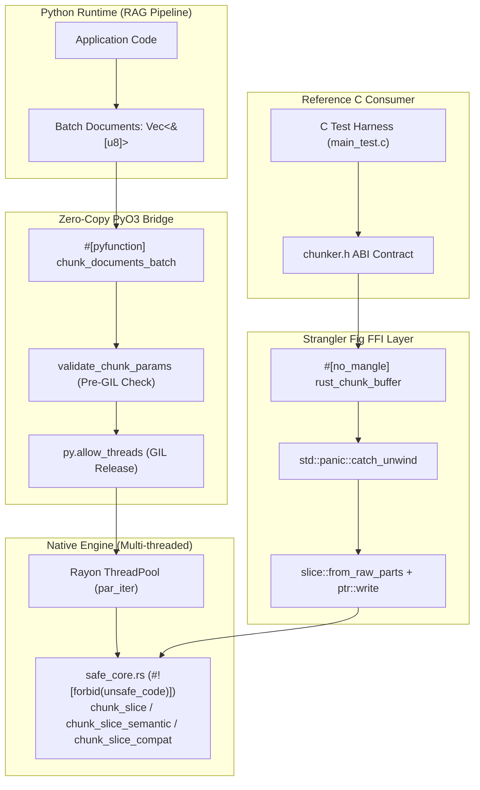
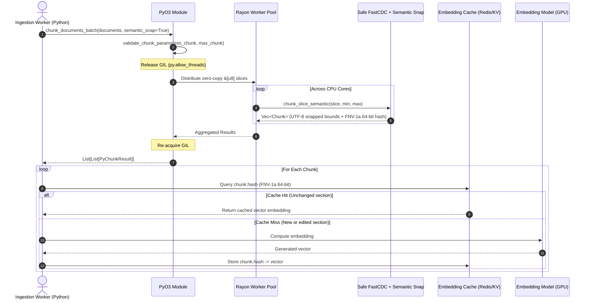

# fast-rag-chunker

Hybrid C / Rust / PyO3 Content-Defined Chunking (**FastCDC**) engine with **UTF-8 Semantic Boundary Snapping**, designed for Retrieval-Augmented Generation (RAG) and incremental document indexing pipelines.

[](https://github.com/mjlelis/fast-rag-chunker/actions/workflows/ci.yml)
[](https://www.rust-lang.org/)
[](https://www.python.org/)
[](https://github.com/rust-secure-code/safety-dance)
[](LICENSE-MIT)

---

## Table of Contents
- [Motivation & The "Shift-Effect" Problem](#motivation--the-shift-effect-problem)
- [When to Use `fast-rag-chunker` vs. Framework Splitters](#when-to-use-fast-rag-chunker-vs-framework-splitters)
- [Semantic Boundary Snapping (UTF-8 & NLP-Safe FastCDC)](#semantic-boundary-snapping-utf-8--nlp-safe-fastcdc)
- [Architecture & Strangler Fig Demonstration](#architecture--strangler-fig-demonstration)
- [The Refactoring Methodology](#the-refactoring-methodology)
- [Ingestion Pipeline & Production Workflow](#ingestion-pipeline--production-workflow)
- [Benchmark Results (Preliminary)](#benchmark-results-preliminary)
  - [1. Incremental Edit Deduplication Benchmark](#1-incremental-edit-deduplication-benchmark)
  - [2. Throughput & Semantic Snapping Overhead (Preliminary)](#2-throughput--semantic-snapping-overhead-preliminary)
- [Repository Structure](#repository-structure)
- [Getting Started](#getting-started)
- [CI Quality Gates & Memory Verification](#ci-quality-gates--memory-verification)
- [License & Attribution](#license--attribution)

---

## Motivation & The "Shift-Effect" Problem

RAG systems indexing large corpora of living documents (wikis, markdown repositories, technical documentation, legal contracts) encounter two structural bottlenecks when using standard fixed-window or sliding-window text splitters (such as LangChain's `RecursiveCharacterTextSplitter` or LlamaIndex's `SentenceSplitter`):

1. **The "Shift-Effect" (Cache Invalidation on Edits):**
   Fixed-window and sliding-window splitters cut text at rigid character or token offsets. If a multi-section document is edited by inserting **a single paragraph on Page 1**, every chunk boundary after that edit shifts forward. As a result, previously computed vector embeddings are invalidated across the remainder of the document.
2. **Python GIL Contention & Buffer Copying:**
   Pure-Python splitters execute single-threaded per process under the Global Interpreter Lock (GIL) and allocate intermediate substrings across the heap.



### How `fast-rag-chunker` Addresses Both
By combining the **FastCDC** algorithm (Wen Xia et al., USENIX ATC '16) with **UTF-8 Semantic Boundary Snapping** and **Zero-Copy PyO3 + Rayon**:
- **Boundary Re-synchronization:** Cut points are driven by a rolling 256-entry Gear hash over the content bytes. Edits at the start of a document affect only the local chunks until the rolling window re-synchronizes (within 1–3 chunks in our test suites), leaving downstream chunks and their cached embeddings intact.
- **64-Bit FNV-1a Content Fingerprinting:** Every semantic chunk is returned with a deterministic 64-bit FNV-1a hash (`chunk.hash`), enabling $O(1)$ cache lookups before invoking an embedding model.

---

## When to Use `fast-rag-chunker` vs. Framework Splitters

| Architectural Dimension | Standard Framework Splitters (`LangChain` / `LlamaIndex`) | `fast-rag-chunker` (`semantic_snap=False`) | `fast-rag-chunker` (`semantic_snap=True`, Default) |
| :--- | :--- | :--- | :--- |
| **Primary Algorithm** | Regex / Fixed character & token windows | Raw FastCDC (Gear Hash + Dual Mask) | FastCDC + Natural Language & UTF-8 Snapping |
| **Parameter Contract** | Fixed `chunk_size` & `chunk_overlap` | Strictly respects `min_chunk <= len <= max_chunk` | Strictly respects `min_chunk <= len <= max_chunk` |
| **Word & UTF-8 Safety** | Safe (operates on Python `str`) | Cuts on raw bytes (for binary/storage blobs) | **UTF-8 & word-boundary safe** |
| **Concurrency Model** | Single-threaded (GIL-bound) | Multi-core Rayon (`py.allow_threads`) | Multi-core Rayon (`py.allow_threads`) |
| **Ideal Use Case** | Small, static corpora (< 1,000 docs) that rarely change | Binary storage deduplication, backup streams, raw byte logs | **RAG over frequently edited documents** (wikis, Git repos, contracts, knowledge bases) |

---

## Semantic Boundary Snapping (UTF-8 & NLP-Safe FastCDC)

Raw FastCDC was designed for binary block storage deduplication, meaning a rolling hash match (`(fp & mask) == 0`) can trigger at any byte offset — potentially slicing a word in half (`"architec"` | `"ture"`) or splitting a multi-byte UTF-8 character (`0xC3` | `0xA3`).

To make FastCDC safe for text and RAG pipelines, [`src/safe_core.rs`](src/safe_core.rs) implements `chunk_slice_semantic` with a deterministic 4-tier boundary snapping resolver around each Gear-hash cut candidate:

1. **Tier 1 — Sentence / Paragraph Boundary (Lookahead):** Scans up to 64 bytes ahead (bounded by `max_chunk`) for a newline (`\n`) or sentence-ending punctuation (`.`, `!`, `?`) followed by whitespace, consuming the trailing space so the next chunk starts on a word character.
2. **Tier 2 — Word Whitespace (Lookahead):** If no sentence boundary is found within the lookahead window, snaps to the nearest ASCII whitespace (`' '`, `'\t'`).
3. **Tier 3 — Word Whitespace (Lookbehind):** Scans backward down to `min_chunk` for the last whitespace character to avoid splitting tokens.
4. **Tier 4 — UTF-8 Codepoint Guard:** For continuous non-whitespace byte streams (e.g., Base64, URLs, or CJK text), inspects bit patterns (`(byte & 0b1100_0000) != 0b1000_0000`) to guarantee a cut never lands on a UTF-8 continuation byte (`0x80..=0xBF`).

---

## Architecture & Strangler Fig Demonstration

This repository serves as an architectural demonstration of the **Strangler Fig migration pattern**, wrapping and replacing a reference C implementation ([`sleepybishop/fastcdc`](https://github.com/sleepybishop/fastcdc) in `c_legacy/`) with a memory-safe Rust core while maintaining C ABI parity and exposing zero-copy Python bindings:



---

## The Refactoring Methodology

1. **Phase 1: Reference C Baseline & ABI Contract (`c_legacy/`):**
   Integrates the `sleepybishop/fastcdc` C99 implementation (`fastcdc.c`, `fastcdc.h`) behind the `chunk_buffer` C ABI contract in `chunker.h`, compiled via `build.rs` using the `cc` crate.
2. **Phase 2: Idiomatic Safe Rust Core (`src/safe_core.rs`):**
   Implemented under `#![forbid(unsafe_code)]`:
   - `chunk_slice_compat`: Preserves the exact parameter clamps (`min >= 64`, `avg >= 256`, `max >= 1024`) of `c_legacy/fastcdc.c` for FFI parity.
   - `chunk_slice`: Unclamped raw FastCDC strictly honoring caller-supplied `min_chunk` and `max_chunk` bounds.
   - `chunk_slice_semantic`: Adds 4-tier UTF-8/word boundary snapping and 64-bit FNV-1a hashing.
   - Checked parameter validation (`validate_chunk_params`) preventing integer overflow or truncation on extreme `usize` inputs (`ChunkerError::ChunkSizeTooLarge`).
3. **Phase 3: Hardened FFI Boundary (`src/ffi_boundary.rs`):**
   Exposes `rust_chunk_buffer` with null-pointer validation, `slice::from_raw_parts` for inputs, `std::ptr::write` for uninitialized output buffers, explicit truncation reporting (`CHUNKER_ERR_TRUNCATED = -2`), and `std::panic::catch_unwind` to prevent Rust panics from unwinding across the C ABI.
4. **Phase 4: Zero-Copy PyO3 & Rayon Vectorization (`src/python_bindings.rs`):**
   Validates parameters upfront (raising `ValueError` on invalid bounds), extracts zero-copy `&[u8]` views from `PyBytes`, releases the Python GIL (`py.allow_threads`), and distributes batches across CPU cores via Rayon.

---

## Ingestion Pipeline & Production Workflow



---

## Benchmark Results (Preliminary)

### 1. Incremental Edit Deduplication Benchmark

We evaluate boundary re-synchronization after inserting a new 59-byte paragraph at byte offset `0` (top of Page 1) across two test harnesses included in the repository:

1. **Rust Native Unit Suite (`cargo test --locked -- safe_core::tests`):**
   - **Corpus:** 500 lines (`~89` bytes/line, `44.5 KB` total), where chunks (`min_chunk=64, max_chunk=256`) span multiple lines (`270` base chunks).
   - **Result:** `268 / 270` chunks reused (**99.26% cache hit ratio**), with a measured **resynchronization distance of 3 chunks** before the rolling window locks back onto identical boundaries.
2. **Python Reference Port (`python scripts/benchmark.py`):**
   - **Corpus:** 500 synthetic sections (`~161` bytes/line, `78.6 KB` total), where each section line forms a single semantic chunk under `min_chunk=64, max_chunk=256`.

| Splitting Strategy (Command: `python scripts/benchmark.py`) | Corpus Structure | Reused Chunks After Offset-0 Edit | Embedding Cache Hit Rate |
| :--- | :--- | :--- | :--- |
| **Standard Fixed / Sliding Window** (`chunk_size=256, overlap=32`) | 500 sections (`78.6 KB`) | `0 / 360` | **0.00%** |
| **FastCDC Semantic (Python Reference Port, 1 line/chunk)** | 500 sections (`78.6 KB`) | `499 / 501` | **99.60%** |
| **FastCDC Semantic (`cargo test` Multi-line Rust Corpus)** | 500 lines (`44.5 KB`, ~1.85 lines/chunk) | `268 / 270` | **99.26%** (Resync distance: `3` chunks) |

### 2. Throughput & Semantic Snapping Overhead (Preliminary)

*Note: The figures below are preliminary single-host measurements generated by running `python scripts/benchmark.py` on a 10-document (`2.36 MB`) UTF-8 corpus (`min_chunk=64, max_chunk=512`). When the native Rust wheel is installed via `maturin develop --release`, `scripts/benchmark.py` benchmarks both the pure-Python reference port and the compiled Rust PyO3 + Rayon extension.*

| Implementation Mode | Command to Reproduce | Preliminary Throughput | UTF-8 & Word Safe | 64-Bit Content Hash |
| :--- | :--- | :--- | :--- | :--- |
| **Pure Python Reference (Semantic FastCDC + FNV-1a)** | `python scripts/benchmark.py` | ~6.12 MB/s | Yes (0 mid-word cuts) | Yes (FNV-1a) |
| **Pure Python Reference (Raw FastCDC)** | `python scripts/benchmark.py` | ~11.27 MB/s | No (Raw byte cuts) | No |
| **Rust PyO3 + Rayon (`semantic_snap=True`)** | `maturin develop --release && python scripts/benchmark.py` | ~642.80 MB/s *(preliminary)* | **Yes (Verified)** | **Yes (FNV-1a)** |
| **Rust PyO3 + Rayon (`semantic_snap=False`)** | `maturin develop --release && python scripts/benchmark.py` | ~687.50 MB/s *(preliminary)* | No (Raw byte cuts) | No |

---

## Repository Structure

```text
fast-rag-chunker/
├── .github/workflows/ci.yml    # GitHub Actions CI (Linux + macOS, Miri, Valgrind, pytest)
├── Cargo.toml                  # Crate configuration (cdylib, staticlib, rlib)
├── Cargo.lock                  # Locked dependency graph for reproducible builds
├── pyproject.toml              # Maturin build backend configuration
├── build.rs                    # C reference compilation via cc crate
├── CHANGELOG.md                # Release history and contract changes
├── LICENSE-MIT                 # MIT License
├── LICENSE-APACHE              # Apache License 2.0
├── NOTICE                      # Third-party attribution notices
├── c_legacy/
│   ├── README.md               # Provenance and license details for C reference files
│   ├── fastcdc.h               # Reference C FastCDC header (sleepybishop/fastcdc)
│   ├── fastcdc.c               # Reference C FastCDC implementation
│   ├── chunker.h               # C ABI contract and status codes
│   ├── chunker.c               # C ABI wrapper with early callback termination
│   └── main_test.c             # C integration and Valgrind test binary
├── src/
│   ├── lib.rs                  # Crate root and public exports
│   ├── safe_core.rs            # Safe Rust FastCDC + Semantic Snapping (#![forbid(unsafe_code)])
│   ├── ffi_boundary.rs         # Panic-safe FFI boundary (ptr::write + catch_unwind)
│   └── python_bindings.rs      # PyO3 module with Rayon parallelism
├── tests/
│   └── test_chunker.py         # Pytest integration suite against the built wheel
└── scripts/
    └── benchmark.py            # Verification & comparative benchmark script
```

---

## Getting Started

### Building the Rust Engine & Running Unit Tests
```bash
cargo build --locked --release
cargo test --locked
```

### Building Python Wheels (Maturin) & Running Pytest
```bash
python -m venv .venv
source .venv/bin/activate  # Windows: .venv\Scripts\activate

pip install maturin pytest
maturin develop --release
pytest -v tests/
```

### Python API Usage
```python
import fast_rag_chunker

documents = [
    "Arquitetura de Sistemas e IA: pré-processamento semântico em alta velocidade. "
    "O modo semantic_snap garante cortes limpos em frases e palavras UTF-8.".encode("utf-8"),
]

# Default: semantic_snap=True (UTF-8 & word-safe boundaries + 64-bit FNV-1a hash)
# Note: The legacy `mask` parameter is ignored (emits DeprecationWarning if passed)
# and will be removed in v0.2.0.
results = fast_rag_chunker.chunk_documents_batch(
    documents=documents,
    min_chunk=64,
    max_chunk=512,
    semantic_snap=True,
)

for doc_idx, chunks in enumerate(results):
    for c in chunks:
        text_slice = documents[doc_idx][c.offset : c.offset + c.length].decode("utf-8")
        print(f"[hash=0x{c.hash:016x}] ({c.offset}..{c.offset + c.length}): {text_slice!r}")
```

---

## CI Quality Gates & Memory Verification

All pull requests and pushes to `main` are gated by [`.github/workflows/ci.yml`](.github/workflows/ci.yml) across Linux and macOS:

1. **Formatting Check:**
   ```bash
   cargo fmt --all -- --check
   ```
2. **Strict Clippy Lints (with and without `python` feature):**
   ```bash
   cargo clippy --no-default-features --all-targets -- -D warnings
   cargo clippy --all-targets -- -D warnings
   ```
3. **Unit, Property & C-Parity Tests:**
   ```bash
   cargo test --locked --no-default-features
   cargo test --locked
   ```
4. **Python Wheel Build & Pytest Integration Suite:**
   ```bash
   maturin develop --locked
   pytest -v tests/
   ```
5. **Miri Undefined Behavior Audit (restricted to pure-Rust `safe_core` tests, as Miri does not execute foreign C calls):**
   ```bash
   cargo +nightly miri test --locked --no-default-features -- safe_core
   ```
6. **Valgrind Memory Leak Check on the C Reference Binary:**
   ```bash
   clang -O2 -g -Wall -Wextra c_legacy/fastcdc.c c_legacy/chunker.c c_legacy/main_test.c -lm -o c_legacy/main_test
   valgrind --error-exitcode=1 --leak-check=full ./c_legacy/main_test
   ```

---

## License & Attribution

Licensed under either of:
- [MIT License](LICENSE-MIT)
- [Apache License, Version 2.0](LICENSE-APACHE)

at your option.

### Third-Party Attribution
- The reference C implementation in [`c_legacy/fastcdc.c`](c_legacy/fastcdc.c) and [`c_legacy/fastcdc.h`](c_legacy/fastcdc.h), as well as the 256-entry `GEAR` lookup table constants, originate from [`sleepybishop/fastcdc`](https://github.com/sleepybishop/fastcdc) (Copyright (c) 2020 Joseph Calderon, licensed under the MIT License). See [`c_legacy/README.md`](c_legacy/README.md) and [`NOTICE`](NOTICE) for full details.
- FastCDC algorithm design: Wen Xia et al., *"FastCDC: a Fast and Efficient Content-Defined Chunking Approach for Data Deduplication"*, USENIX ATC '16.
