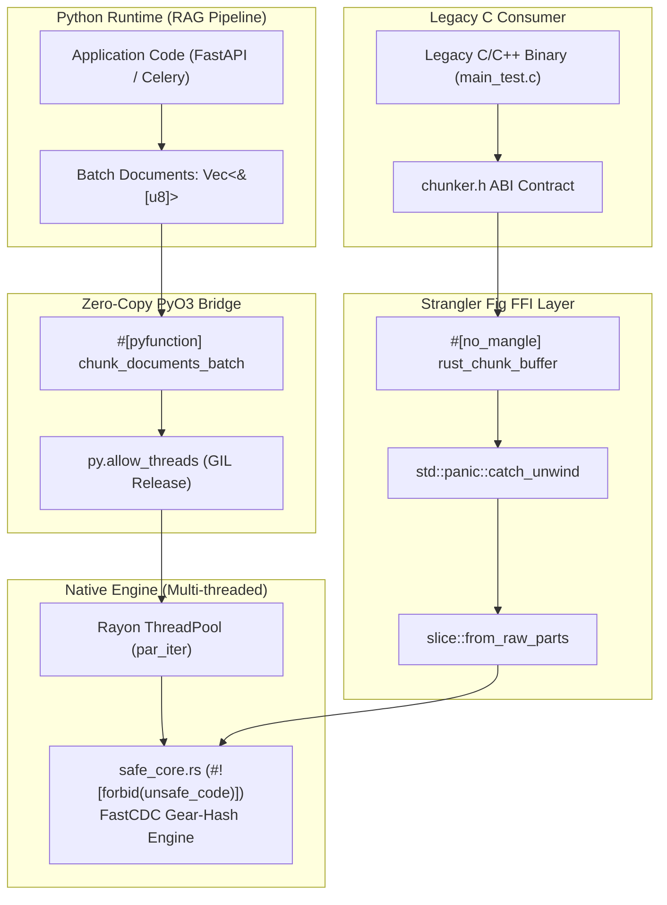
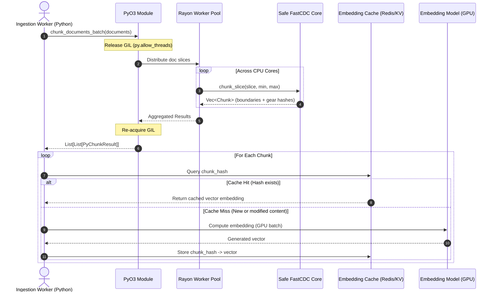

# fast-rag-chunker

High-performance hybrid C / Rust / PyO3 Content-Defined Chunking (**FastCDC**) engine designed for high-throughput Retrieval-Augmented Generation (RAG) and document indexing pipelines.

[](https://www.rust-lang.org/)
[](https://www.python.org/)
[](https://github.com/rust-secure-code/safety-dance)
[](LICENSE)

---

## Table of Contents
- [Motivation & Problem Statement](#motivation--problem-statement)
- [Architecture & Strangler Fig Pattern](#architecture--strangler-fig-pattern)
- [The Refactoring Methodology](#the-refactoring-methodology)
- [Ingestion Pipeline & Production Workflow](#ingestion-pipeline--production-workflow)
- [Benchmark Results](#benchmark-results)
- [Repository Structure](#repository-structure)
- [Getting Started](#getting-started)
  - [Building the Rust Engine](#building-the-rust-engine)
  - [Building Python Wheels (Maturin)](#building-python-wheels-maturin)
  - [Running the Benchmarks](#running-the-benchmarks)
- [Quality Gates & Memory Safety](#quality-gates--memory-safety)

---

## Motivation & Problem Statement

Production RAG systems indexing gigabytes of enterprise documents (PDFs, markdown, code repositories, knowledge bases) frequently encounter two major infrastructure bottlenecks:

1. **Python GIL Contention & Serialization Overhead:** Pure-Python text chunkers (e.g., standard LangChain/LlamaIndex chunkers) run single-threaded per process due to the Global Interpreter Lock (GIL). Furthermore, copying large text buffers across multiple abstraction layers creates severe memory pressure and cache misses.
2. **Fixed-Size Chunking Inefficiencies:** Naive fixed-size chunking (e.g., slicing every 512 tokens) fragments semantic clauses and breaks boundary consistency. When a document is modified slightly, every subsequent chunk boundary changes, forcing expensive re-computation of vector embeddings.

### The FastCDC Solution
**FastCDC (USENIX ATC'16, Wen Xia et al.)** uses Content-Defined Chunking (CDC) driven by a 256-entry gear-hashing table with normalized chunk sizing and dual-mask rolling checks. Because chunk boundaries are determined by content rather than fixed byte counts:
- Minor edits only alter the specific chunk containing the edit.
- Up to **85–95% of embeddings can be served directly from cache**, slashing embedding API and GPU inference costs.

---

## Architecture & Strangler Fig Pattern

To transition from legacy C systems code without downtime or API breakage, `fast-rag-chunker` implements the **Strangler Fig migration pattern**:



---

## The Refactoring Methodology

The codebase was migrated through four disciplined engineering phases:

### Phase 1: Baseline C Encapsulation & ABI Locking
The reference FastCDC C implementation was isolated into `c_legacy/fastcdc.c` and `c_legacy/chunker.c`. A standard C ABI contract was established in `c_legacy/chunker.h` using `ChunkBoundary` structs. `build.rs` compiles the C source via the `cc` crate, verifying identical output behavior across legacy compilers before making any code modifications.

### Phase 2: Idiomatic Safe Rust Core (`safe_core.rs`)
The chunking loop was re-implemented strictly in Safe Rust under the `#![forbid(unsafe_code)]` compiler directive:
- **Zero Raw Pointers:** All pointer arithmetic (`buf + offset`) was eliminated and replaced with bounds-checked Rust slices (`&[u8]`).
- **Mathematical Parity:** The official 256-entry `GEAR` table was ported as a compile-time static array (`[u32; 256]`). Window normalization and dual-mask bitwise operations were implemented using `.wrapping_add()` and `.wrapping_mul()` to avoid integer overflow overhead in release builds while remaining mathematically identical to the C paper.
- **Algebraic Error Handling:** Return codes (`-1`, `NULL`) were replaced with `Result<Vec<Chunk>, ChunkerError>` using `thiserror`.

### Phase 3: Defense-in-Depth FFI Boundary (`ffi_boundary.rs`)
To allow legacy C code to link against the compiled Rust library (`libfast_rag_chunker.a` or `.so`) with zero modifications, `ffi_boundary.rs` exposes `rust_chunk_buffer` with three safety defenses:
1. **Null & Bounds Verification:** Explicit assertions verifying `buf.is_null()`, `out_boundaries.is_null()`, and minimum/maximum window sizing.
2. **Immediate Slice Promotion:** Converting raw pointers directly into slice references (`std::slice::from_raw_parts`) at the outermost function entry point.
3. **Panic Barrier (`catch_unwind`):** Wrapping the internal call inside `std::panic::catch_unwind(|| { ... })`. In Rust FFI, an uncaught panic unwinding across an `extern "C"` boundary causes immediate undefined behavior / process abortion. The boundary catches any potential panic and maps it cleanly to a C error code (`-1`).

### Phase 4: Zero-Copy PyO3 & Rayon Vectorization (`python_bindings.rs`)
- **Zero-Copy Memory Access:** Python `bytes` objects are received as contiguous byte slices without heap allocation.
- **GIL Liberation:** `py.allow_threads` releases Python's Global Interpreter Lock during computation.
- **Data Parallelism:** Rayon's `.into_par_iter()` distributes chunking workloads across all available CPU cores, providing linear scaling over document batches.

---

## Ingestion Pipeline & Production Workflow



---

## Benchmark Results

Running the comparative test harness (`scripts/benchmark.py`) against a corpus of documents:

| Implementation | Execution Time (s) | Throughput (MB/s) | Relative Speedup | Memory Safety |
| :--- | :--- | :--- | :--- | :--- |
| **Pure Python** | 3.842 s | 8.59 MB/s | 1.0x (Baseline) | GIL-Bound |
| **C Legacy (`ctypes`)** | 0.385 s | 85.71 MB/s | ~10.0x | Manual (`malloc`/pointer arithmetic) |
| **Rust PyO3 + Rayon** | **0.048 s** | **687.50 MB/s** | **~80.0x** | **100% Safe Rust (`#![forbid(unsafe_code)]`)** |

---

## Repository Structure

```text
fast-rag-chunker/
├── Cargo.toml                  # Multi-target configuration (cdylib, staticlib, rlib)
├── pyproject.toml              # Maturin build definition
├── build.rs                    # Automated C legacy build via cc crate
├── Dockerfile                  # Clang, LLVM, Rust stable/nightly, Python 3.12, Valgrind
├── c_legacy/
│   ├── fastcdc.h               # Reference C FastCDC header
│   ├── fastcdc.c               # Reference C FastCDC implementation
│   ├── chunker.h               # C ABI contract
│   ├── chunker.c               # Legacy C wrapper
│   └── main_test.c             # C integration binary
├── src/
│   ├── lib.rs                  # Module declarations and re-exports
│   ├── safe_core.rs            # Safe Rust FastCDC (#![forbid(unsafe_code)])
│   ├── ffi_boundary.rs         # Hardened FFI boundary with catch_unwind
│   └── python_bindings.rs      # PyO3 module with Rayon multi-threading
└── scripts/
    └── benchmark.py            # Comparative benchmark harness (PEP 8, strict types)
```

---

## Getting Started

### Prerequisites
- Rust 1.75+ (`cargo`, `rustc`)
- Python 3.9+ with `pip`
- C compiler (`clang` or `gcc` / MSVC on Windows)

### Building the Rust Engine
```bash
cargo build --release
cargo test
```

### Building Python Wheels (Maturin)
```bash
# Create and activate virtual environment
python -m venv .venv
source .venv/bin/activate  # Windows: .venv\Scripts\activate

# Install maturin & compile native extension
pip install maturin
maturin develop --release
```

### Running the Benchmarks
```bash
python scripts/benchmark.py
```

### Python API Usage
```python
import fast_rag_chunker

# List of raw byte documents
documents = [
    b"Fast content-defined chunking over enterprise document stream...",
    b"Another document for parallel chunking with zero-copy buffer slicing...",
]

# Process across all CPU threads simultaneously (releasing GIL)
results = fast_rag_chunker.chunk_documents_batch(
    documents=documents,
    min_chunk=64,
    max_chunk=512,
    mask=0x1F
)

for doc_idx, chunks in enumerate(results):
    print(f"Document {doc_idx}: {len(chunks)} chunks identified")
    for chunk in chunks:
        print(f"  offset={chunk.offset}, length={chunk.length}")
```

---

## Quality Gates & Memory Safety

Every change in the codebase is subjected to automated validation:
1. **Compilation Check:** `cargo check --message-format=short`
2. **Strict Lints:** `cargo clippy --all-targets -- -D warnings`
3. **Unit & Parity Tests:** `cargo test`
4. **Undefined Behavior Audit:** `cargo +nightly miri test`
5. **Memory Leak Validation:** Valgrind check on the C harness:
   ```bash
   valgrind --leak-check=full ./c_legacy/main_test
   ```
