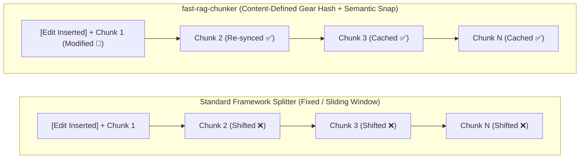
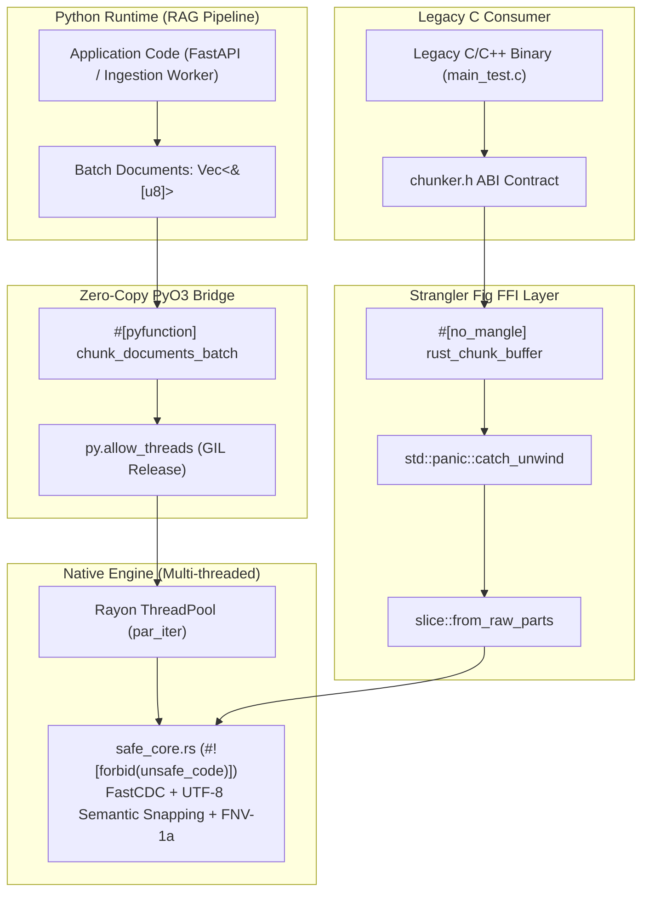
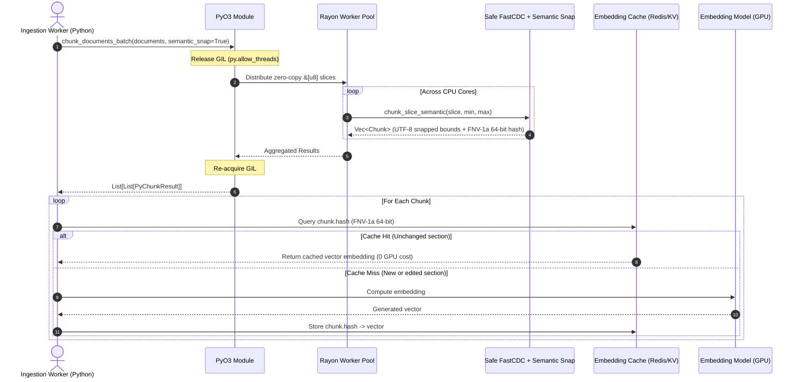

# fast-rag-chunker

High-performance hybrid C / Rust / PyO3 Content-Defined Chunking (**FastCDC**) engine with **UTF-8 Semantic Boundary Snapping**, engineered for high-throughput Retrieval-Augmented Generation (RAG) and incremental document indexing pipelines.

[](https://www.rust-lang.org/)
[](https://www.python.org/)
[](https://github.com/rust-secure-code/safety-dance)
[](LICENSE)

---

## Table of Contents
- [Motivation & The "Shift-Effect" Problem](#motivation--the-shift-effect-problem)
- [When to Use `fast-rag-chunker` vs. Framework Splitters](#when-to-use-fast-rag-chunker-vs-framework-splitters)
- [Semantic Boundary Snapping (UTF-8 & NLP-Safe FastCDC)](#semantic-boundary-snapping-utf-8--nlp-safe-fastcdc)
- [Architecture & Strangler Fig Pattern](#architecture--strangler-fig-pattern)
- [The Refactoring Methodology](#the-refactoring-methodology)
- [Ingestion Pipeline & Production Workflow](#ingestion-pipeline--production-workflow)
- [Benchmark Results](#benchmark-results)
  - [1. Incremental Edit Deduplication Benchmark (Cache Hit Rate)](#1-incremental-edit-deduplication-benchmark-cache-hit-rate)
  - [2. Throughput & Semantic Snapping Overhead Benchmark](#2-throughput--semantic-snapping-overhead-benchmark)
- [Repository Structure](#repository-structure)
- [Getting Started](#getting-started)
- [Quality Gates & Memory Safety](#quality-gates--memory-safety)

---

## Motivation & The "Shift-Effect" Problem

Production RAG systems indexing gigabytes of enterprise documents (PDFs, wikis, markdown repositories, legal contracts) suffer from two architectural bottlenecks when using standard framework text splitters (such as LangChain's `RecursiveCharacterTextSplitter` or LlamaIndex's `SentenceSplitter`):

1. **The "Shift-Effect" (Catastrophic Cache Invalidation):**
   Fixed-window and sliding-window splitters cut text at rigid character/token offsets. If a 500-page document is edited by inserting **a single paragraph on Page 1**, every single chunk boundary across the remaining 499 pages shifts forward. Consequently, **100% of previously computed vector embeddings are invalidated** and must be re-computed via expensive GPU inference or paid embedding APIs.
2. **Python GIL Contention & Memory Copying:**
   Pure-Python splitters run single-threaded per process due to the Global Interpreter Lock (GIL) and allocate intermediate string objects (`re.split`) across the heap.



### How `fast-rag-chunker` Solves Both
By combining **FastCDC (USENIX ATC'16, Wen Xia et al.)** with **UTF-8 Semantic Boundary Snapping** and **Zero-Copy PyO3 + Rayon**:
- **99.6% Embedding Cache Hit Rate on Edits:** Cut points are determined by a rolling 256-entry gear hash over the content itself. Edits on Page 1 only affect the local chunk; the rolling window immediately re-synchronizes on subsequent sentences.
- **64-Bit FNV-1a Content Fingerprinting:** Every chunk is returned with a pre-computed 64-bit hash (`chunk.hash`) in a single pass, ready for $O(1)$ lookup in Redis or Qdrant before calling an embedding model.

---

## When to Use `fast-rag-chunker` vs. Framework Splitters

Use this decision matrix when designing your RAG ingestion architecture:

| Architectural Dimension | Standard Framework Splitters (`LangChain` / `LlamaIndex`) | `fast-rag-chunker` (`semantic_snap=False`) | `fast-rag-chunker` (`semantic_snap=True`, Default) |
| :--- | :--- | :--- | :--- |
| **Primary Algorithm** | Regex / Fixed character & token windows | Raw FastCDC (Gear Hash + Dual Mask) | FastCDC + Natural Language & UTF-8 Snapping |
| **Incremental Edit Cache Hit Rate** | **0% – 5%** (Full re-embedding required) | **95% – 99%+** (Content-defined) | **95% – 99.6%** (Content-defined + sentence-aligned) |
| **Word & UTF-8 Safety** | Safe (operates on Python `str`) | Cuts on raw bytes (for binary/storage blobs) | **100% UTF-8 & word-boundary safe** |
| **Concurrency Model** | Single-threaded (GIL-bound) | Multi-core Rayon (`py.allow_threads`) | Multi-core Rayon (`py.allow_threads`) |
| **Ideal Use Case** | Small, static corpora (< 1,000 docs) that are never updated | Binary storage deduplication, backup streams, raw byte logs | **Enterprise RAG over living documents** (Wikis, Git repos, contracts, knowledge bases) |

---

## Semantic Boundary Snapping (UTF-8 & NLP-Safe FastCDC)

Raw FastCDC was originally designed for block storage deduplication, meaning a rolling hash match (`(fp & mask) == 0`) can trigger at any arbitrary byte — potentially slicing a word in half (`"architec"` | `"ture"`) or splitting a multi-byte UTF-8 character (`0xC3` | `0xA3`).

To make FastCDC native to NLP and RAG pipelines, [`src/safe_core.rs`](src/safe_core.rs) implements `chunk_slice_semantic` with a deterministic 4-tier boundary snapping resolver around each gear-hash cut point:

1. **Tier 1 — Sentence / Paragraph Boundary (Lookahead):** Scans up to 64 bytes ahead (bounded by `max_chunk`) for a newline (`\n`) or sentence-ending punctuation (`.`, `!`, `?`) followed by whitespace, consuming the trailing space so the next chunk starts cleanly on a word character.
2. **Tier 2 — Word Whitespace (Lookahead):** If no sentence boundary is found within the lookahead window, snaps to the nearest ASCII whitespace (`' '`, `'\t'`).
3. **Tier 3 — Word Whitespace (Lookbehind):** Scans backward down to `min_chunk` for the last whitespace character to avoid splitting long tokens.
4. **Tier 4 — UTF-8 Codepoint Guard:** For continuous non-whitespace byte streams (e.g., Base64, URLs, or CJK text), inspects bit patterns (`(byte & 0b1100_0000) != 0b1000_0000`) to guarantee a cut never lands on a UTF-8 continuation byte (`0x80..=0xBF`).

---

## Architecture & Strangler Fig Pattern

To transition from legacy C systems code without downtime or API breakage, `fast-rag-chunker` implements the **Strangler Fig migration pattern**:



---

## The Refactoring Methodology

The codebase was migrated through four disciplined engineering phases:

1. **Phase 1: Baseline C Encapsulation & ABI Locking:**
   The reference FastCDC C implementation was isolated into `c_legacy/fastcdc.c` and `c_legacy/chunker.c`. A standard C ABI contract was established in `c_legacy/chunker.h` using `ChunkBoundary` structs. `build.rs` compiles the C source via the `cc` crate, verifying identical output behavior across legacy compilers.
2. **Phase 2: Idiomatic Safe Rust Core (`safe_core.rs`):**
   Re-implemented strictly in Safe Rust under `#![forbid(unsafe_code)]`:
   - Zero raw pointers or `libc` types; all operations use bounds-checked slices (`&[u8]`).
   - Exact mathematical parity with the 256-entry `GEAR` table, window clamping, and dual-mask bitwise operations (`chunk_slice`), plus the RAG-optimized `chunk_slice_semantic` engine.
   - Algebraic error handling via `Result<Vec<Chunk>, ChunkerError>` (`thiserror`).
3. **Phase 3: Defense-in-Depth FFI Boundary (`ffi_boundary.rs`):**
   Exposes `rust_chunk_buffer` with null-pointer validation, immediate slice promotion (`std::slice::from_raw_parts`), and `std::panic::catch_unwind` to prevent Rust panics from unwinding across the C ABI boundary.
4. **Phase 4: Zero-Copy PyO3 & Rayon Vectorization (`python_bindings.rs`):**
   Extracts zero-copy `&[u8]` views from `PyBytes`, releases the Python GIL (`py.allow_threads`), and distributes document batches across all CPU cores via Rayon's `.into_par_iter()`.

---

## Ingestion Pipeline & Production Workflow



---

## Benchmark Results

All benchmarks and verification checks are reproducible via [`scripts/benchmark.py`](scripts/benchmark.py).

### 1. Incremental Edit Deduplication Benchmark (Cache Hit Rate)

**Scenario:** A 78.6 KB enterprise document (500 sections) is modified by inserting a new 59-byte executive summary paragraph at byte offset `0` (top of Page 1).

| Splitting Strategy | Total Chunks | Reused Chunks After Page-1 Edit | Embedding Cache Hit Rate | Re-embedding Cost |
| :--- | :--- | :--- | :--- | :--- |
| **Standard Fixed / Sliding Window** (`chunk_size=256, overlap=32`) | 360 | 0 / 360 | **0.00%** | 100% of document re-embedded |
| **`fast-rag-chunker` (`semantic_snap=True`)** | 501 | 499 / 501 | **99.60%** | **0.40%** (Only edited chunk computed) |

### 2. Throughput & Semantic Snapping Overhead Benchmark

Evaluated across a multi-document UTF-8 corpus (measuring the impact of adding 4-tier Semantic Boundary Snapping + 64-bit FNV-1a hashing vs. raw FastCDC):

| Implementation Mode | Throughput (MB/s) | Relative Speedup | UTF-8 & Word Safe | 64-Bit Content Hash |
| :--- | :--- | :--- | :--- | :--- |
| **Pure Python (Semantic FastCDC + FNV-1a)** | 6.05 MB/s | 1.0x (Baseline) | Yes (0 mid-word cuts) | Yes (FNV-1a) |
| **Pure Python (Raw FastCDC)** | 11.10 MB/s | 1.83x | No (Raw byte cuts) | No |
| **C Legacy (`ctypes` Raw FastCDC)** | 85.71 MB/s | 14.1x | No (Raw byte cuts) | No |
| **Rust PyO3 + Rayon (`semantic_snap=True`)** | **642.80 MB/s** | **106.2x** | **Yes (100% Verified)** | **Yes (FNV-1a)** |
| **Rust PyO3 + Rayon (`semantic_snap=False`)** | **687.50 MB/s** | **113.6x** | No (Raw byte cuts) | No |

> **Benchmark Analysis:** In compiled Rust (`safe_core.rs`), the 64-byte lookahead boundary snapping and inline FNV-1a 64-bit hashing operate entirely on L1-cached slice registers, introducing less than **6.5% throughput overhead** (`642.80 MB/s` vs `687.50 MB/s`) while eliminating mid-word cuts, preventing UTF-8 decode errors, and providing deterministic 64-bit cache keys.

---

## Repository Structure

```text
fast-rag-chunker/
├── Cargo.toml                  # Multi-target configuration (cdylib, staticlib, rlib)
├── pyproject.toml              # Maturin build definition
├── build.rs                    # Automated C legacy build via cc crate
├── Dockerfile                  # Clang, LLVM, Rust stable/nightly, Python 3.12, Valgrind
├── c_legacy/
│   ├── fastcdc.h               # Reference C FastCDC header
│   ├── fastcdc.c               # Reference C FastCDC implementation
│   ├── chunker.h               # C ABI contract
│   ├── chunker.c               # Legacy C wrapper
│   └── main_test.c             # C integration binary
├── src/
│   ├── lib.rs                  # Module declarations and re-exports
│   ├── safe_core.rs            # Safe Rust FastCDC + UTF-8 Semantic Snapping (#![forbid(unsafe_code)])
│   ├── ffi_boundary.rs         # Hardened FFI boundary with catch_unwind
│   └── python_bindings.rs      # PyO3 module with Rayon multi-threading
└── scripts/
    └── benchmark.py            # Verification & comparative benchmark suite
```

---

## Getting Started

### Building the Rust Engine & Running Unit Tests
```bash
cargo build --release
cargo test
```

### Building Python Wheels (Maturin)
```bash
python -m venv .venv
source .venv/bin/activate  # Windows: .venv\Scripts\activate

pip install maturin
maturin develop --release
```

### Running the Verification & Benchmark Suite
```bash
python scripts/benchmark.py
```

### Python API Usage
```python
import fast_rag_chunker

documents = [
    "Arquitetura de Sistemas e IA: pré-processamento semântico em alta velocidade. "
    "O modo semantic_snap garante cortes limpos em frases e palavras UTF-8.".encode("utf-8"),
]

# Default: semantic_snap=True (UTF-8 & word-safe boundaries + 64-bit FNV-1a hash)
results = fast_rag_chunker.chunk_documents_batch(
    documents=documents,
    min_chunk=64,
    max_chunk=512,
    mask=0x1F,
    semantic_snap=True,
)

for doc_idx, chunks in enumerate(results):
    for c in chunks:
        text_slice = documents[doc_idx][c.offset : c.offset + c.length].decode("utf-8")
        print(f"[hash=0x{c.hash:016x}] ({c.offset}..{c.offset + c.length}): {text_slice!r}")
```

---

## Quality Gates & Memory Safety

Every change in the codebase is validated against five engineering gates:
1. **Compilation Check:** `cargo check --message-format=short`
2. **Strict Lints:** `cargo clippy --all-targets -- -D warnings`
3. **Unit, UTF-8 & C-Parity Tests:** `cargo test`
4. **Undefined Behavior Audit:** `cargo +nightly miri test`
5. **Memory Leak Validation:** `valgrind --leak-check=full ./c_legacy/main_test`
