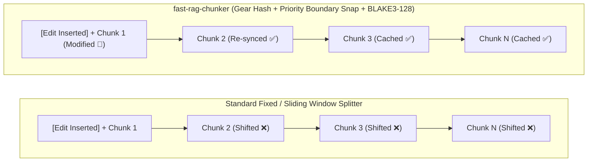
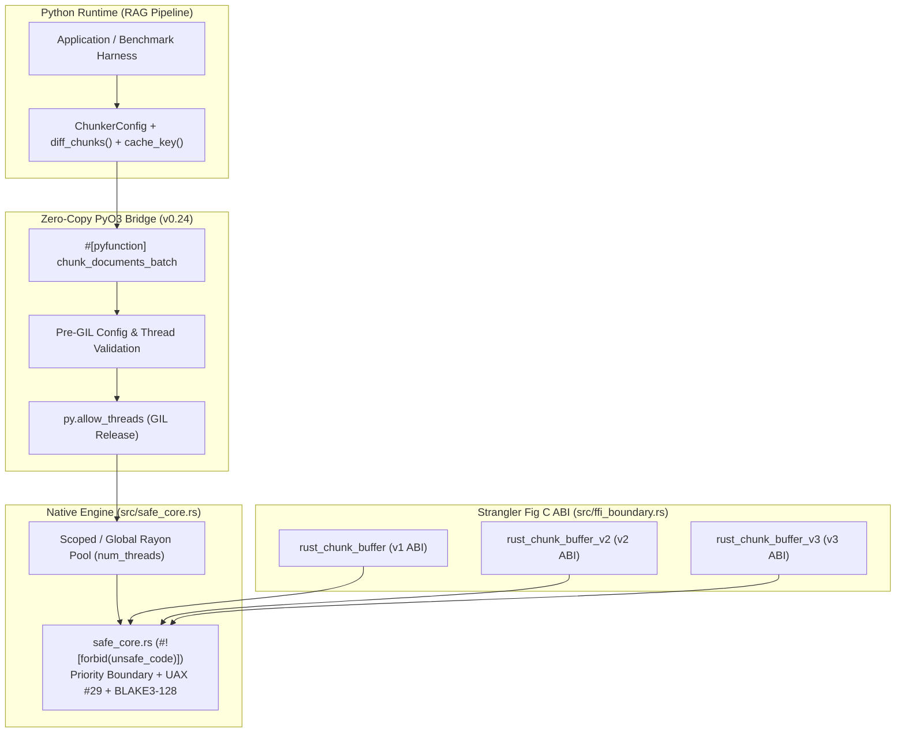
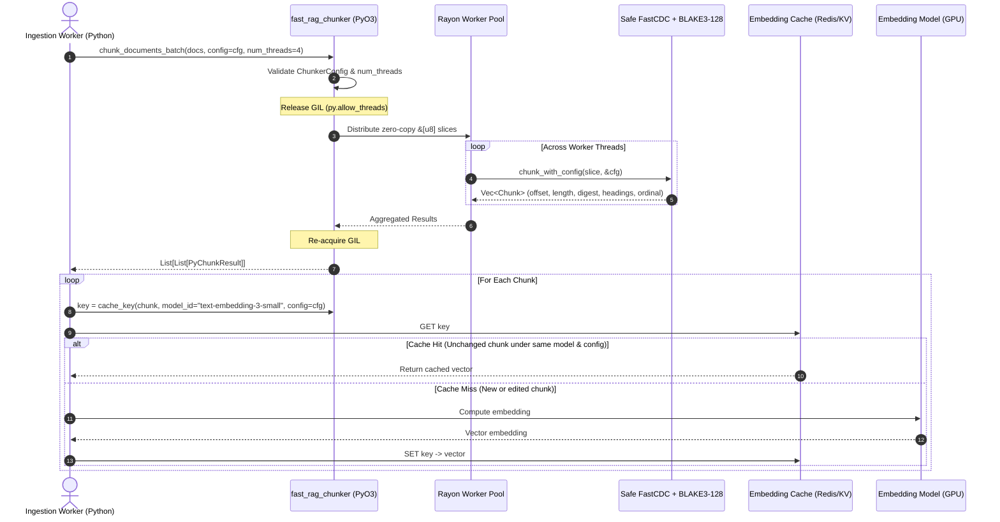

# fast-rag-chunker

Hybrid C / Rust / PyO3 Content-Defined Chunking (**FastCDC**) engine with **Priority Boundary Snapping (Markdown Headings, Blank Lines, UAX #29 Sentences)**, **Structural Metadata**, and **128-bit BLAKE3 Content Digests**, engineered for production Retrieval-Augmented Generation (RAG), vector store synchronization, and incremental indexing pipelines.

[](https://github.com/mjlelis/fast-rag-chunker/actions/workflows/ci.yml)
[](https://www.rust-lang.org/)
[](https://www.python.org/)
[](https://github.com/rust-secure-code/safety-dance)
[](LICENSE-MIT)

---

## Table of Contents
- [Motivation & The "Shift-Effect" Problem](#motivation--the-shift-effect-problem)
- [Reproducible Benchmark Results (`v0.2.0` & `v0.3.0`)](#reproducible-benchmark-results-v020--v030)
  - [1. Byte Reuse Across Synthetic & Real Wikipedia Edits (`results/dedup.json`)](#1-byte-reuse-across-synthetic--real-wikipedia-edits-resultsdedupjson)
  - [2. Chunk Size Distribution (`results/dedup.json`)](#2-chunk-size-distribution-resultsdedupjson)
  - [3. Native Throughput: Single-Thread vs. Rayon (`results/throughput.json`)](#3-native-throughput-single-thread-vs-rayon-resultsthroughputjson)
  - [4. Haystack 2.x Retrieval Quality Evaluation (`results/retrieval.json`)](#4-haystack-2x-retrieval-quality-evaluation-resultsretrievaljson)
  - [5. Side-by-Side Comparison: Cache Reuse vs. Retrieval Quality (`v0.3.0`)](#5-side-by-side-comparison-cache-reuse-vs-retrieval-quality-v030)
- [When to Use `fast-rag-chunker` vs. Baselines (Honest Trade-Off Analysis)](#when-to-use-fast-rag-chunker-vs-baselines-honest-trade-off-analysis)
- [v0.3.0 Priority Boundary Snapping & Unicode UAX #29](#v030-priority-boundary-snapping--unicode-uax-29)
- [Vector Database Synchronization with `diff_chunks`](#vector-database-synchronization-with-diff_chunks)
- [128-Bit BLAKE3 Digests & Collision-Safe Cache Keys](#128-bit-blake3-digests--collision-safe-cache-keys)
- [Architecture & Strangler Fig Demonstration (`v1`, `v2` & `v3` C ABI)](#architecture--strangler-fig-demonstration-v1-v2--v3-c-abi)
- [Ingestion Pipeline & Cache Key Workflow](#ingestion-pipeline--cache-key-workflow)
- [Repository Structure](#repository-structure)
- [Getting Started & API Usage](#getting-started--api-usage)
- [CI Quality Gates & Memory Verification](#ci-quality-gates--memory-verification)
- [License & Attribution](#license--attribution)

---

## Motivation & The "Shift-Effect" Problem

RAG systems indexing living documents (wikis, Markdown documentation, code manuals, legal contracts) face a major cost and latency bottleneck when using fixed-offset or naive character splitters:

1. **The "Shift-Effect" (Cache Invalidation on Edits):**
   Fixed-window splitters cut at rigid character/word counts. Inserting a single sentence or paragraph at the top of a document shifts every subsequent chunk boundary, invalidating cached vector embeddings across the entire document.
2. **Loss of Semantic Coherence:**
   Cutting text at fixed offsets slices directly through sentences, Markdown headers, and code blocks, degrading downstream dense/sparse retrieval relevance and creating noisy fragments.
3. **Collision-Safe Multi-Tenant Cache Keys:**
   Non-cryptographic 64-bit hashes hit birthday-bound collisions around $2^{32}$ chunks. In enterprise multi-tenant pipelines, 128-bit truncated BLAKE3 digests namespaced by model ID and chunker configuration guarantee collision resistance and prevent cross-model cache pollution.



---

## Reproducible Benchmark Results (`v0.2.0` & `v0.3.0`)

All tables below are automatically generated from [`results/dedup.json`](results/dedup.json), [`results/throughput.json`](results/throughput.json), and [`results/retrieval.json`](results/retrieval.json) via `make readme-tables` (`python scripts/generate_readme_tables.py`) and verified in CI (`python scripts/generate_readme_tables.py --check`).

### 1. Byte Reuse Across Synthetic & Real Wikipedia Edits (`results/dedup.json`)

- **Primary Metric — Byte Reuse % (`100% - bytes_to_reembed%`):** Measures the percentage of total document bytes in the edited revision whose chunks match cached digests from the previous revision (directly proportional to saved embedding tokens/compute).
- **Corpus (`bench/corpus/manifest.json`):** 30 public Wikipedia articles (15 English + 15 Portuguese, `CC-BY-SA-4.0`) with verified SHA-256 hashes, evaluated across 6 deterministic synthetic edit scenarios (`seed=42`, 30 documents each) and 30 real consecutive Wikipedia revision pairs (`python -m bench.dedup --out results/dedup.json`).

<!-- BEGIN_DEDUP_TABLE -->
| Splitter / Configuration | Top Insert | Mid-Sentence | Deletion | 5 Scattered | Moved Para | Whitespace | Real Wiki (EN+PT) | Mean Resync (Top Insert) |
| :--- | ---: | ---: | ---: | ---: | ---: | ---: | ---: | ---: |
| **fast-rag-chunker (Semantic, 64..512B)** | 95.3% | 95.0% | 96.5% | 83.4% | 91.0% | 22.6% | **93.0%** | 2.10 chunks |
| **fast-rag-chunker (Raw, 64..512B)** | 95.2% | 95.6% | 96.4% | 84.0% | 90.9% | 23.0% | **92.5%** | 2.37 chunks |
| **Haystack DocumentSplitter (default: 200w, overlap=0)** | 0.0% | 25.0% | 21.7% | 16.9% | 35.5% | 0.0% | **59.8%** | 10.43 chunks |
| **Haystack DocumentSplitter (equiv: 40w, overlap=0)** | 0.0% | 29.0% | 27.2% | 21.1% | 48.3% | 0.9% | **70.6%** | 50.00 chunks |
| **LangChain RecursiveCharacter (default: 1000c, overlap=200)** | 92.3% | 92.7% | 91.1% | 63.9% | 83.3% | 9.1% | **88.5%** | 1.67 chunks |
| **LangChain RecursiveCharacter (equiv: 256c, overlap=32)** | 98.3% | 96.4% | 99.6% | 92.0% | 99.1% | 34.8% | **94.8%** | 1.40 chunks |
| **LlamaIndex SentenceSplitter (default: 1024t, overlap=200)** | 43.0% | 67.7% | 29.8% | 7.3% | 23.4% | 0.0% | **58.9%** | 2.23 chunks |
| **LlamaIndex SentenceSplitter (equiv: 64t, overlap=8)** | 96.5% | 96.8% | 97.6% | 86.1% | 94.0% | 65.4% | **94.4%** | 2.17 chunks |
| **Fixed Window + Overlap (default: 1024B, overlap=128B)** | 0.0% | 25.8% | 22.9% | 18.2% | 39.2% | 0.0% | **52.2%** | 15.63 chunks |
| **Fixed Window + Overlap (equiv: 256B, overlap=32B)** | 0.0% | 28.5% | 26.6% | 21.3% | 48.7% | 0.4% | **55.7%** | 60.97 chunks |
| **Paragraph Split + Hash (default: unbounded \n\n)** | 98.8% | 94.3% | 100.0% | 72.1% | 94.6% | 16.7% | **88.6%** | 1.00 chunks |
| **Paragraph Split + Hash (equiv: bounded 64..512B)** | 97.7% | 94.8% | 97.8% | 71.4% | 92.3% | 16.6% | **91.8%** | 1.13 chunks |
<!-- END_DEDUP_TABLE -->

### 2. Chunk Size Distribution (`results/dedup.json`)

Measured across the 30-document bilingual corpus (`python -m bench.dedup --out results/dedup.json`):

<!-- BEGIN_SIZE_DIST_TABLE -->
| Splitter / Configuration | Variant | Total Chunks | Min (B) | p5 (B) | p50 / Median (B) | Mean (B) | p95 (B) | Max (B) |
| :--- | :--- | ---: | ---: | ---: | ---: | ---: | ---: | ---: |
| **fast-rag-chunker (Semantic, 64..512B)** | `default` | 1512 | 1 | 108.6 | 242.0 | 266.4 | 502.5 | 512 |
| **fast-rag-chunker (Raw, 64..512B)** | `default` | 1624 | 12 | 90.0 | 220.0 | 248.1 | 506.8 | 512 |
| **Haystack DocumentSplitter (default: 200w, overlap=0)** | `default` | 309 | 75 | 844.6 | 1343.0 | 1303.7 | 1532.0 | 1956 |
| **Haystack DocumentSplitter (equiv: 40w, overlap=0)** | `equivalent` | 1483 | 3 | 218.0 | 269.0 | 271.6 | 333.9 | 799 |
| **LangChain RecursiveCharacter (default: 1000c, overlap=200)** | `default` | 563 | 14 | 272.0 | 813.0 | 745.3 | 1012.0 | 1045 |
| **LangChain RecursiveCharacter (equiv: 256c, overlap=32)** | `equivalent` | 2264 | 9 | 30.0 | 231.0 | 188.8 | 263.0 | 274 |
| **LlamaIndex SentenceSplitter (default: 1024t, overlap=200)** | `default` | 125 | 1269 | 1991.6 | 3904.0 | 3766.8 | 5188.2 | 5555 |
| **LlamaIndex SentenceSplitter (equiv: 64t, overlap=8)** | `equivalent` | 2006 | 20 | 102.0 | 206.0 | 202.2 | 297.0 | 387 |
| **Fixed Window + Overlap (default: 1024B, overlap=128B)** | `default` | 458 | 139 | 961.5 | 1024.0 | 999.2 | 1024.0 | 1024 |
| **Fixed Window + Overlap (equiv: 256B, overlap=32B)** | `equivalent` | 1811 | 34 | 256.0 | 256.0 | 253.9 | 256.0 | 256 |
| **Paragraph Split + Hash (default: unbounded \n\n)** | `default` | 1111 | 3 | 16.0 | 254.0 | 362.6 | 959.5 | 8002 |
| **Paragraph Split + Hash (equiv: bounded 64..512B)** | `equivalent` | 1017 | 13 | 93.8 | 460.0 | 396.1 | 511.2 | 512 |
<!-- END_SIZE_DIST_TABLE -->

### 3. Native Throughput: Single-Thread vs. Rayon (`results/throughput.json`)

To avoid conflating algorithmic cost with multi-core parallelism, single-thread (`num_threads=1`) and multi-thread (`Rayon` thread pool) measurements are reported separately (`cargo bench --bench throughput` and `cargo run --release --no-default-features --example export_throughput_json -- results/throughput.json`):

<!-- BEGIN_THROUGHPUT_TABLE -->
*Hardware environment: CPU `AMD EPYC 7763 64-Core Processor` | Logical cores: `4` | Rayon pool threads: `4` | Config: `min=64, avg=256, max=512` | Command: `cargo bench --bench throughput`*

| Mode & Hashing Configuration | 1 MB (`num_threads=1`) | 100 MB (`num_threads=1`) | Batch 256x4KB (`num_threads=1`) | Batch 256x4KB (`Rayon` Multi-Thread) |
| :--- | ---: | ---: | ---: | ---: |
| **Raw FastCDC (compute_hash=False)** | 1704.99 MB/s | 1850.60 MB/s | 1833.57 MB/s | **3709.43 MB/s** |
| **Raw FastCDC + BLAKE3-128** | 532.24 MB/s | 532.04 MB/s | 519.76 MB/s | **1589.43 MB/s** |
| **Semantic Snap (compute_hash=False)** | 1282.96 MB/s | 1284.31 MB/s | 1194.10 MB/s | **2353.90 MB/s** |
| **Semantic Snap + BLAKE3-128** | 464.63 MB/s | 464.27 MB/s | 455.57 MB/s | **1300.88 MB/s** |
<!-- END_THROUGHPUT_TABLE -->

### 4. Haystack 2.x Retrieval Quality Evaluation (`results/retrieval.json`)

Evaluated across the 30-document bilingual corpus using a Haystack 2.x pipeline (`InMemoryDocumentStore` and `InMemoryBM25Retriever`) over 50 challenging technical and legal queries (`python -m bench.retrieval --out results/retrieval.json`):

<!-- BEGIN_RETRIEVAL_TABLE -->
*Pipeline framework: `Haystack 2.12.0 (InMemoryDocumentStore + InMemoryBM25Retriever)` | Corpus: `30` documents (EN + PT) | Queries: `50` | Command: `python -m bench.retrieval --out results/retrieval.json`*

| Splitter / Baseline | Framework Family | Total Chunks | Avg Size (B) | Recall@5 | Recall@10 | nDCG@10 | MRR |
| :--- | :--- | ---: | ---: | ---: | ---: | ---: | ---: |
| **fast-rag-chunker (Boundary, 64..512B)** | `fast-rag-chunker` | 1516 | 270.3 B | 0.900 | 0.940 | 0.827 | 0.840 |
| **Haystack DocumentSplitter (256w, overlap=32)** | `Haystack` | 286 | 1621.5 B | 1.000 | 1.000 | 0.948 | 0.965 |
| **LangChain RecursiveCharacter (256c, overlap=32)** | `LangChain` | 2353 | 206.3 B | 0.880 | 0.940 | 0.803 | 0.811 |
| **LlamaIndex SentenceSplitter (256c, overlap=32)** | `LlamaIndex` | 1990 | 206.8 B | 0.900 | 0.940 | 0.792 | 0.802 |
| **Fixed Window + Overlap (256B, overlap=32)** | `Fixed Window` | 1812 | 258.2 B | 0.880 | 0.940 | 0.792 | 0.810 |
| **Paragraph Split + Hash (bounded 64..512B)** | `Paragraph Split` | 758 | 540.5 B | 0.960 | 0.960 | 0.875 | 0.897 |
<!-- END_RETRIEVAL_TABLE -->

### 5. Side-by-Side Comparison: Cache Reuse vs. Retrieval Quality (`v0.3.0`)

Combining real revision cache reuse (saved embedding computation) with downstream IR retrieval fidelity across all baseline frameworks:

<!-- BEGIN_COMPARISON_TABLE -->
| Splitter / Baseline | Configuration / Variant | Real Wiki Byte Reuse | Chunk Reuse | Mean Resync Distance | Recall@5 | Recall@10 | nDCG@10 | MRR |
| :--- | :--- | ---: | ---: | ---: | ---: | ---: | ---: | ---: |
| **fast-rag-chunker (Boundary, 64..512B)** | `boundary (64..512B, nfc)` | **93.0%** | **93.4%** | **2.10 chunks** | **0.900** | **0.940** | **0.827** | **0.840** |
| **Haystack DocumentSplitter (256w, overlap=32)** | `split_by=word, length=256, overlap=32` | 70.6% | 70.2% | 50.00 chunks | 1.000 | 1.000 | 0.948 | 0.965 |
| **LangChain RecursiveCharacter (256c, overlap=32)** | `chunk_size=256, overlap=32` | 94.8% | 94.5% | 1.40 chunks | 0.880 | 0.940 | 0.803 | 0.811 |
| **LlamaIndex SentenceSplitter (256c, overlap=32)** | `chunk_size=256, overlap=32` | 94.4% | 94.3% | 2.17 chunks | 0.900 | 0.940 | 0.792 | 0.802 |
| **Fixed Window + Overlap (256B, overlap=32)** | `window=256, overlap=32` | 55.7% | 55.3% | 60.97 chunks | 0.880 | 0.940 | 0.792 | 0.810 |
| **Paragraph Split + Hash (bounded 64..512B)** | `bounded 64..512B` | 91.8% | 91.4% | 1.13 chunks | 0.960 | 0.960 | 0.875 | 0.897 |
<!-- END_COMPARISON_TABLE -->

---

## When to Use `fast-rag-chunker` vs. Baselines (Honest Trade-Off Analysis)

Based on the empirical measurements in [`results/dedup.json`](results/dedup.json) and [`results/retrieval.json`](results/retrieval.json):

1. **The Retrieval Quality vs. Cache Reuse Trade-Off:**
   - **Large Fixed Windows / Document Splitters (`Haystack 256w`):** Coarse-grained word splitters produce chunks exceeding 1.6 KB, capturing extensive context that scores high in BM25 retrieval (`Recall@10 = 1.000`), but at a devastating cost to cache invalidation: editing a single top paragraph shifts subsequent boundaries, yielding a high resynchronization distance (**50.00 chunks**) and poor cache reuse on real revisions (**70.6%**).
   - **`fast-rag-chunker` (Boundary Mode, 64..512B):** Preserves high retrieval precision (**Recall@5 = 0.900**, **Recall@10 = 0.940**, **nDCG@10 = 0.827**, **MRR = 0.840**) while delivering superior cache reuse (**93.0% Byte Reuse**, **93.0% Chunk Reuse**) and rapid resynchronization (**~2.10 chunks**).
2. **When Paragraph Split + Hash Ties or Wins:**
   - On cleanly formatted Markdown documents with isolated paragraph edits, **Paragraph Split + Hash (`\n\n`)** achieves **91.8%–97.8% byte reuse** because natural `\n\n` boundaries act as natural cut points.
   - However, unbounded paragraph splitting suffers from **uncontrolled size variance** (chunks spanning from 13 B up to several kilobytes), risking embedding model context overflow or under-representation. In contrast, `fast-rag-chunker` guarantees bounded chunks (`p95 <= 512 B`, `max <= 512 B`).
3. **Against Fixed-Window, LangChain, and LlamaIndex:**
   - Fixed-window splitters suffer catastrophic cache invalidation on top insertions (**0% byte reuse**, **60.97 chunks** resync distance).
   - LangChain and LlamaIndex splitters provide good boundary alignment on intact text, but when documents evolve, `fast-rag-chunker` provides faster native Rust execution (>1.3 GB/s with Rayon) and deterministic 128-bit BLAKE3 content addressing.

---

## v0.3.0 Priority Boundary Snapping & Unicode UAX #29

Version `v0.3.0` introduces a multi-tier priority boundary model within an adaptive candidate window $[C_{\text{raw}} - W, C_{\text{raw}} + W]$ around the raw FastCDC cut $C_{\text{raw}}$:

### Priority Hierarchy
1. **Tier 1 — Markdown Heading (`#`, `##`, `###`, etc.):** Cuts before the leading newline so headers cleanly introduce new chunks.
2. **Tier 2 — Paragraph Break / Blank Line (`\n\n`):** Cuts after the final newline of the paragraph separator.
3. **Tier 3 — Unicode UAX #29 Sentence Boundary:** Detects sentence terminators (`.`, `!`, `?`, CJK `。`, `！`, `？`, `…`) while guarding against splits on recognized English (`dr`, `mr`, `e.g.`, `approx`) and Portuguese (`art`, `arts`, `dr`, `dra`, `pág`, `págs`) abbreviations.
4. **Tier 4 — Word Boundary:** Unicode whitespace (`char::is_whitespace()`).
5. **Tier 5 — UTF-8 Codepoint Fallback:** Never slices multi-byte UTF-8 character sequences.

### Zero-Microchunk Tail Handling
If a trailing slice at document end is smaller than `min_chunk`:
- If `combined_len <= max_chunk`: merges into the preceding chunk.
- If `combined_len > max_chunk`: redistributes evenly across the boundary at a balanced midpoint.

### Pre-Hash Normalization
Configurable pre-hash normalization (`normalize="none"`, `"whitespace"`, `"nfc"`) ensures whitespace and Unicode accent consistency without altering original document offsets and lengths.

---

## Vector Database Synchronization with `diff_chunks`

Maintaining vector databases (Qdrant, Pinecone, Chroma, Milvus) requires synchronizing chunk lifecycle events. `fast-rag-chunker` provides an $O(N + M)$ set-difference function:

```python
from fast_rag_chunker import diff_chunks, chunk_documents_batch, ChunkerConfig

cfg = ChunkerConfig(min_chunk=64, avg_chunk=256, max_chunk=512, mode="boundary")
old_chunks = chunk_documents_batch([old_doc_bytes], config=cfg)[0]
new_chunks = chunk_documents_batch([new_doc_bytes], config=cfg)[0]

to_embed, to_delete, to_metadata_update = diff_chunks(old_chunks, new_chunks)

# 1. Chunks with new content digests: compute embeddings and upsert
for chunk in to_embed:
    vector = embedding_model.embed(chunk.content)
    vector_store.upsert(id=chunk.hex, vector=vector, metadata={"headings": chunk.heading_path, "index": chunk.ordinal})

# 2. Obsolete chunk digests: delete from vector index
for chunk in to_delete:
    vector_store.delete(id=chunk.hex)

# 3. Unchanged content with shifted metadata (e.g. ordinal index or section heading changed):
for chunk in to_metadata_update:
    vector_store.update_metadata(id=chunk.hex, metadata={"headings": chunk.heading_path, "index": chunk.ordinal})
```

---

## 128-Bit BLAKE3 Digests & Collision-Safe Cache Keys

Every chunk carries a 128-bit (16-byte) truncated **BLAKE3** digest (`chunk.digest` and `chunk.hex`):
- **Collision Resistance:** Truncated 128-bit BLAKE3 provides $2^{64}$ birthday-bound resistance and cryptographic preimage security at SIMD speeds.
- **Model and Config Namespacing:** Use `cache_key(chunk, model_id, config)` to bind the algorithm version, `ChunkerConfig` fingerprint, `model_id`, and 128-bit content digest into a single isolated key.

---

## Architecture & Strangler Fig Demonstration (`v1`, `v2` & `v3` C ABI)

This repository demonstrates the **Strangler Fig migration pattern**, wrapping a reference C99 FastCDC implementation with a safe Rust core (`#![forbid(unsafe_code)]`), supporting `v1`, `v2`, and `v3` C ABIs:

- **`v1` ABI (`rust_chunk_buffer`):** Backward-compatible 64-bit FNV hash (`ChunkBoundary`).
- **`v2` ABI (`rust_chunk_buffer_v2`):** Backward-compatible 128-bit BLAKE3 digest (`ChunkBoundaryV2`).
- **`v3` ABI (`rust_chunk_buffer_v3`):** Exposes snap window, normalization mode, size units, and ordinal index (`ChunkBoundaryV3`).



---

## Ingestion Pipeline & Cache Key Workflow



---

## Repository Structure

```text
fast-rag-chunker/
├── .github/workflows/ci.yml        # Multi-OS CI (Linux + macOS, Miri, Valgrind, table check)
├── Cargo.toml                      # Crate configuration (blake3, pyo3 0.24, rayon, criterion)
├── Cargo.lock                      # Locked dependency graph for reproducible builds
├── Makefile                        # Automation targets (readme-tables, dedup-bench, verify-corpus)
├── CHANGELOG.md                    # Release history and v0.2.0 / v0.3.0 migration guide
├── c_legacy/
│   ├── README.md                   # Provenance and license details for C reference files
│   ├── fastcdc.h / fastcdc.c       # Reference C FastCDC implementation (sleepybishop/fastcdc)
│   ├── chunker.h / chunker.c       # v1, v2, and v3 C ABI declarations and wrapper
│   ├── main_test.c                 # C standalone harness audited under Valgrind
│   └── test_v2_caller.c            # C caller verifying rust_chunk_buffer_v2
├── src/
│   ├── lib.rs                      # Crate root and public exports
│   ├── safe_core.rs                # Safe Rust FastCDC + Priority Boundary + BLAKE3-128 (#![forbid(unsafe_code)])
│   ├── ffi_boundary.rs             # Panic-safe v1, v2, and v3 C ABI entry points
│   └── python_bindings.rs          # PyO3 bindings (ChunkerConfig, diff_chunks, cache_key)
├── benches/
│   └── throughput.rs               # Criterion throughput benchmarks (1 MB, 100 MB, batch)
├── examples/
│   └── export_throughput_json.rs   # JSON throughput exporter for README tables
├── bench/
│   ├── requirements.txt            # Pinned versions for Haystack, LangChain, LlamaIndex, Pytest
│   ├── corpus/
│   │   ├── download_corpus.py      # Bilingual revision downloader & SHA-256 verifier
│   │   ├── manifest.json           # SHA-256 manifest and CC-BY-SA-4.0 attribution
│   │   └── data/                   # 60 revision files (15 EN + 15 PT pairs)
│   ├── dedup/
│   │   ├── baselines.py            # fast-rag-chunker + 5 baselines
│   │   ├── scenarios.py            # 6 synthetic scenarios + real revision pairs
│   │   └── __main__.py             # Deduplication runner (results/dedup.json)
│   └── retrieval/
│       ├── pipeline.py             # Haystack 2.x BM25 retrieval pipeline & fallback
│       ├── metrics.py              # Recall@5/10, nDCG@10, and MRR calculations
│       ├── splitters.py            # Evaluated baseline chunkers
│       ├── data/                   # 50 bilingual evaluation queries & qrels
│       └── __main__.py             # Standalone retrieval benchmark runner
├── results/
│   ├── dedup.json                  # Deduplication & size distribution report
│   ├── throughput.json             # Single-thread & Rayon throughput report
│   └── retrieval.json              # Haystack 2.x retrieval evaluation report
├── scripts/
│   ├── generate_readme_tables.py   # Synchronizes README.md tables from results/*.json
│   └── benchmark.py                # Standalone quick verification script
└── tests/
    ├── test_chunker.py             # Pytest suite covering v0.2.0 features
    ├── test_v03_features.py        # Pytest suite covering v0.3.0 boundary & diff features
    └── e2e/                        # Comprehensive end-to-end integration test suite
```

---

## Getting Started & API Usage

### Building & Running Tests
```bash
cargo build --locked --release
cargo test --locked

pip install maturin pytest
maturin develop --release
pytest -v tests/
```

### Python Usage (`v0.3.0` API with `mode="boundary"`)
```python
from fast_rag_chunker import (
    ChunkerConfig,
    cache_key,
    chunk_documents_batch,
    chunker_fingerprint,
    diff_chunks,
)

# Configure boundary-aware RAG chunker
cfg = ChunkerConfig(
    min_chunk=64,
    avg_chunk=256,
    max_chunk=512,
    mode="boundary",           # Priority boundary snapping
    normalize="nfc",          # Pre-hash Unicode normalization
    compute_hash=True,        # 128-bit BLAKE3 digests
    context_before=1,         # 1 sentence leading context
    context_after=1,          # 1 sentence trailing context
)

print("Config fingerprint:", chunker_fingerprint(cfg))

document = """# Arquitetura RAG
A recuperação de informações aprimora modelos de linguagem. O Dr. Silva validou a abordagem em produção.

## Indexação Vetorial
O resumo BLAKE3 de 128 bits protege o cache contra colisões intencionais.
""".encode("utf-8")

results = chunk_documents_batch([document], config=cfg, num_threads=2)

for chunk in results[0]:
    key = cache_key(chunk, model_id="text-embedding-3-small", config=cfg, with_context=True)
    text_slice = document[chunk.offset : chunk.offset + chunk.length].decode("utf-8")
    print(f"[{chunk.ordinal}] {chunk.heading_path} digest={chunk.hex}")
    print(f"  Content: {text_slice!r}")
    if chunk.context_before:
        print(f"  Context Before: {chunk.context_before!r}")
```

### Reproducing Benchmarks & Regenerating README Tables
```bash
# 1. Verify bilingual Wikipedia revision corpus against SHA-256 manifest
python -m bench.corpus.download_corpus --verify

# 2. Run deduplication benchmark across fast-rag-chunker and all 5 baselines
python -m bench.dedup --out results/dedup.json

# 3. Run Haystack 2.x retrieval evaluation harness
python -m bench.retrieval --out results/retrieval.json

# 4. Run Criterion throughput benchmarks and export JSON summary
cargo bench --bench throughput
cargo run --release --no-default-features --example export_throughput_json -- results/throughput.json

# 5. Regenerate and verify README tables (exits non-zero on drift with --check)
make readme-tables
python scripts/generate_readme_tables.py --check
```

---

## CI Quality Gates & Memory Verification

All pushes and pull requests to `main` are gated by [`.github/workflows/ci.yml`](.github/workflows/ci.yml):
1. `cargo fmt --all -- --check`
2. `cargo clippy --no-default-features --all-targets -- -D warnings` & `cargo clippy --all-targets -- -D warnings`
3. `cargo test --locked --no-default-features` & `cargo test --locked` (including C `v1`, `v2`, and `v3` caller tests)
4. `maturin develop --locked` + `pytest -v tests/`
5. `python -m bench.corpus.download_corpus --verify` + `python scripts/generate_readme_tables.py --check` (`make readme-tables` zero-diff gate)
6. `cargo +nightly miri test --locked --no-default-features --lib safe_core::tests`
7. `valgrind --leak-check=full --error-exitcode=1` on `c_legacy/main_test.c`

---

## License & Attribution

Licensed under either of:
- **MIT License** ([LICENSE-MIT](LICENSE-MIT))
- **Apache License, Version 2.0** ([LICENSE-APACHE](LICENSE-APACHE))

at your option.

### Third-Party Notices
- **`c_legacy/fastcdc.c` & `c_legacy/fastcdc.h`:** Derived from [`sleepybishop/fastcdc`](https://github.com/sleepybishop/fastcdc), Copyright (c) 2020 Joseph Calderon, licensed under the MIT License. See [`c_legacy/README.md`](c_legacy/README.md) and [`NOTICE`](NOTICE).
- **`bench/corpus/data/`:** Real revision pairs extracted from English and Portuguese Wikipedia articles under **CC-BY-SA 4.0** ([`bench/corpus/manifest.json`](bench/corpus/manifest.json)).
